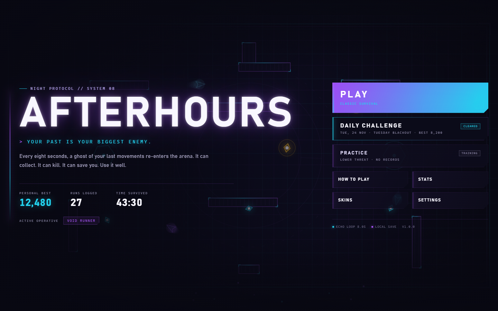
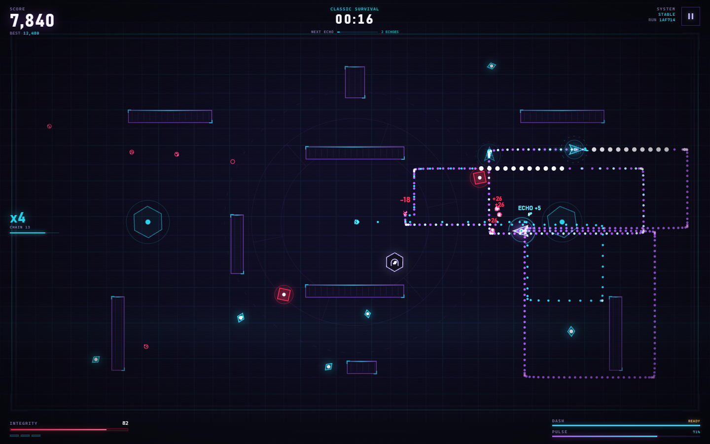
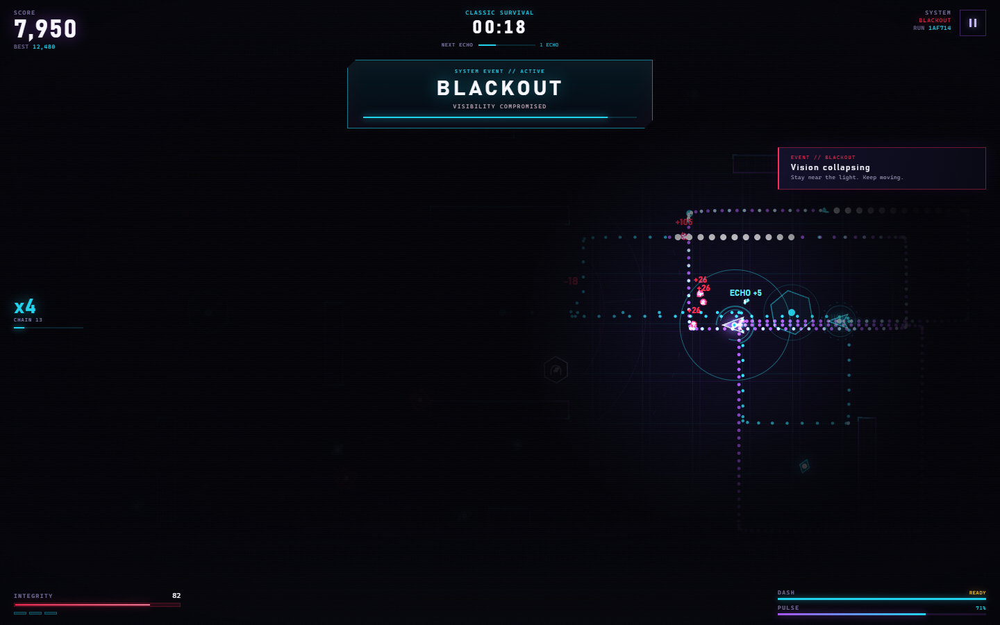
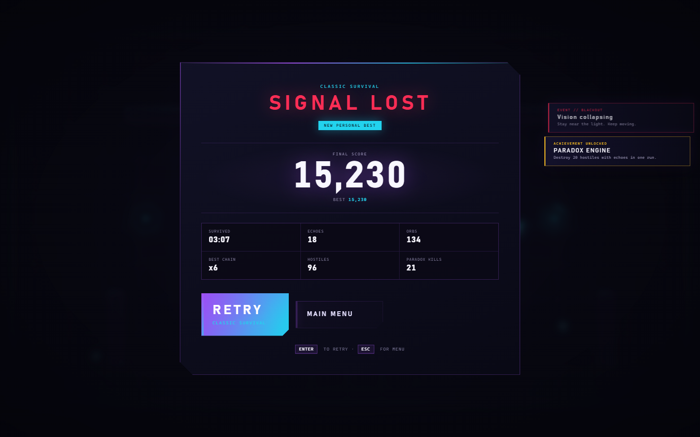
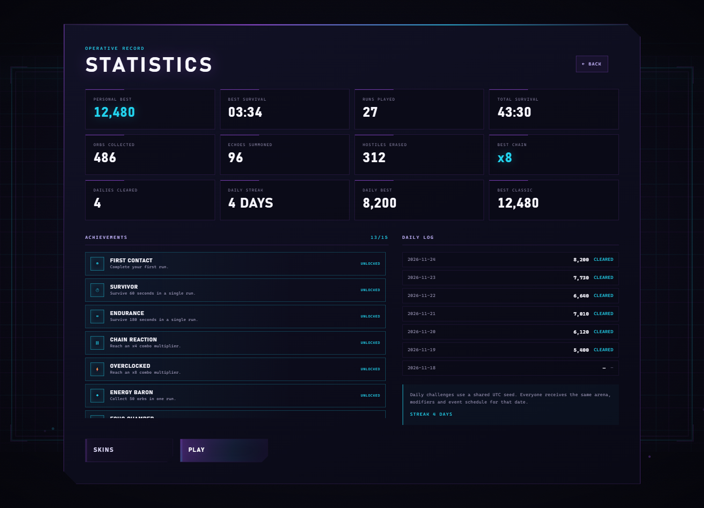
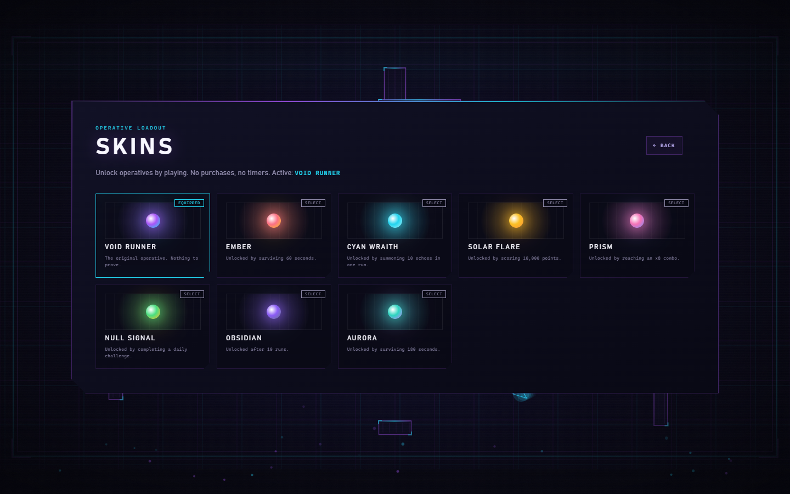
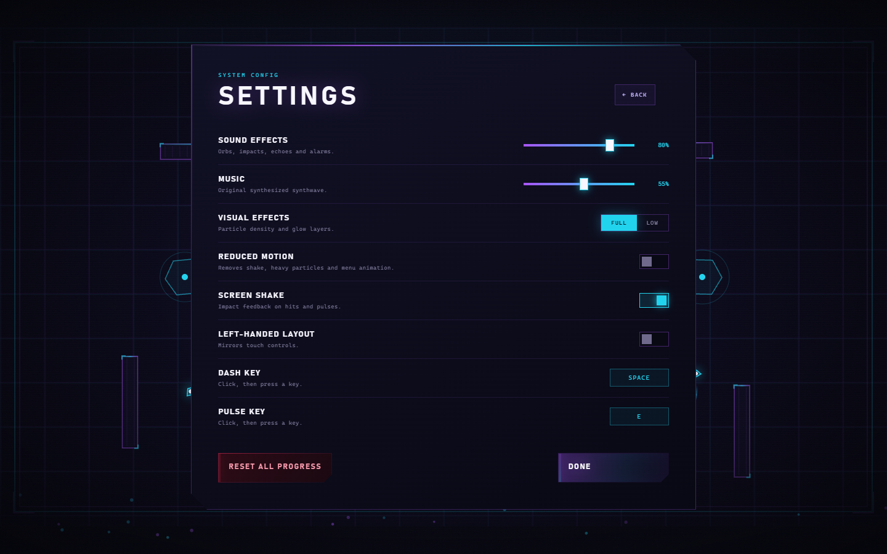
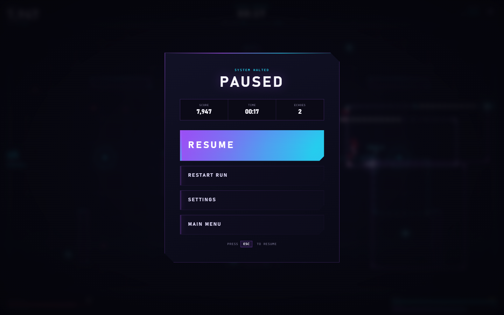
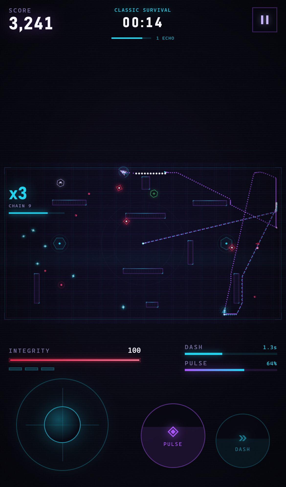

# AFTERHOURS

**Your past is your biggest enemy.**

AFTERHOURS is a neon survival arcade game that runs entirely in the browser. Every eight seconds the system replays your last eight seconds of movement as a hostile echo — a ghost that copies your path, collects energy and hunts the same hostiles you do. Learn to use your own past, or be buried by it.

[**Play the live game →**](https://afterhours-arcade.pages.dev)



## The echo loop

1. **Move.** Your position, facing and dash state are sampled at 30 Hz into a bounded rolling buffer.
2. **Echo.** At the eight-second mark, the last eight seconds are replayed as an echo. Playback is driven by simulation time and interpolated timestamps, so it is identical on 60 Hz and 144 Hz displays.
3. **Adapt.** Echoes can collect orbs at half score, charge relays and destroy hostiles. Hostiles are also attracted to echoes, which makes them useful bait. The arena slowly fills with your own past.

There is no rewind button. The only way to change what comes back is to change how you play now.

## Features

- **Signature echo replay** — timestamped 30 Hz recording, 8-second loop, multiple simultaneous echoes, bounded memory, frame-rate-independent interpolation.
- **Three modes** — Classic Survival, Daily Challenge and Practice.
- **Daily Challenge** — seeded from the UTC date (`AFTERHOURS::YYYY-MM-DD`), so every player gets the same arena, spawn stream and event schedule. Each weekday has its own modifier and identity, and completing a daily builds a streak.
- **Four hostile classes** — Hunter, Interceptor, Sentry and Glitch, each with distinct movement and attack behavior.
- **Five arena-wide events** — Blackout, Double Echo, Glitch, Overload and Invert, each with a three-second warning and an active HUD banner.
- **Combat toolkit** — directional dash with cooldown, a chargeable pulse shockwave that damages hostiles and deletes projectiles, shields, combo multiplier and six temporary power-ups.
- **Progression** — lifetime stats, 15 achievements, 8 cosmetic skins, daily history and LocalStorage persistence. Practice runs never touch records, lifetime counters or achievements.
- **Synthesized audio** — every sound effect and the adaptive music loop are generated with the Web Audio API. Sound and music volumes are separate.
- **Desktop and mobile** — WASD/arrows plus rebindable dash and pulse keys; on touch devices, a floating virtual stick and two action buttons.
- **Accessibility and comfort** — reduced-motion mode, screen-shake toggle, low-effects mode, left-handed touch layout and live-updating HUD values.
- **No backend, no accounts, no paid APIs** — the game is a static bundle.

## Screenshots

| Gameplay | Echoes and events |
| --- | --- |
|  |  |

| Game over | Progression |
| --- | --- |
|  |  |

| Skins | Settings |
| --- | --- |
|  |  |

| Pause | Mobile |
| --- | --- |
|  |  |

## Modes

| Mode | Rules | Records |
| --- | --- | --- |
| **Classic Survival** | Standard threat curve, events and echoes. | Best score, best time, all lifetime stats and achievements. |
| **Daily Challenge** | The same seeded run for everyone on a given UTC day. Survive 60 seconds to clear it. Weekday modifiers change speed, energy, event weighting or echo frequency. | Daily history, best daily score, streak, daily achievements. |
| **Practice** | 125 integrity, slower hostiles, fewer spawns and less frequent events. | No records, no lifetime stats, no achievements. |

## Controls

| Action | Keyboard | Touch |
| --- | --- | --- |
| Move | `WASD` or arrow keys | Floating virtual stick (left side) |
| Dash | `Space` (rebindable) | Dash button |
| Pulse | `E` (rebindable) | Pulse button |
| Pause / resume | `Esc` or `P` | Pause button in the HUD |
| Confirm / restart | `Enter` | On-screen buttons |

Dash and pulse can be rebound from **Settings → Controls**. The touch layout can be mirrored for left-handed play.

## Scoring and progression

- Orbs add score and charge the pulse meter. Echoes collect orbs for half value.
- Chaining pickups and kills raises the multiplier, up to **x8**.
- Relays are charged by standing inside them; completing a relay damages nearby hostiles.
- Health is integrity. Shields absorb one hit before integrity is lost.
- Achievements unlock skins; skins are cosmetic only and never affect stats.
- All progress is stored locally under `afterhours.save.v1`. Nothing leaves the device.

## Tech

- **HTML5 Canvas 2D** rendering with a fixed 60 Hz simulation step and delta-time movement.
- **Vanilla JavaScript ES Modules** — no UI framework and no runtime dependencies.
- **Vite** for the dev server and production build.
- **Web Audio API** for all music and sound effects.
- **LocalStorage** for saves, settings, records, achievements and daily history.

```
src/
  main.js                 bootstrap and system wiring
  game/
    Game.js               lifecycle, run state, progression, fixed-step loop
    Player.js             movement, dash, pulse charge, health
    EchoRecorder.js       30 Hz timestamped recording buffer
    Echo.js               interpolated deterministic replay
    Enemy.js              hunter / interceptor / sentry / glitch AI
    Spawner.js            seeded spawn director
    EventDirector.js      warnings and five arena events
    CombatSystem.js       combat, pickups, relays, shockwave
    Arena.js              arena bounds, obstacles, glitch geometry
    Renderer.js           canvas rendering and effects
    AudioManager.js       synthesized SFX and adaptive music
    InputManager.js       keyboard, rebinding and touch controls
    ...
  systems/
    RNG.js                xmur3 + mulberry32 deterministic randomness
    DailyChallenge.js     UTC date seed and weekday modifiers
    Storage.js            versioned LocalStorage save schema
    Achievements.js       pure achievement predicates
    Skins.js              cosmetic unlocks
  ui/                     screens, HUD, menus, settings
  styles/main.css         responsive neon interface
tools/smoke-test.mjs      Node-only deterministic system tests
```

## Run locally

Requirements: Node.js 20.19+ or 22.12+ (Vite 7 requirement) and npm.

```bash
npm install
npm run dev       # http://localhost:5173
npm run build     # production bundle in dist/
npm run preview   # preview the production build
```

## Tests

The smoke suite runs in plain Node with no browser or test framework:

```bash
npm run test:smoke
```

It covers seeded RNG reproducibility, daily seed and weekday modifiers, echo recorder bounds and history, deterministic and frame-rate-independent echo playback, difficulty pacing, practice-mode record exclusion, daily streaks, save migration/fallback, achievements and skin unlock rules.

## Deploy to Cloudflare Pages

The live build is hosted on Cloudflare Pages at **https://afterhours-arcade.pages.dev**.

Manual deploy with Wrangler:

```bash
npm run build
npx wrangler pages deploy dist --project-name=afterhours-arcade
```

Or connect the GitHub repository in the Cloudflare dashboard:

- **Framework preset:** None / Vite
- **Build command:** `npm run build`
- **Build output directory:** `dist`
- **Node version:** 22

The optional `.github/workflows/deploy.yml` workflow can deploy from GitHub Actions when `CLOUDFLARE_API_TOKEN` and `CLOUDFLARE_ACCOUNT_ID` repository secrets are configured. The default `.github/workflows/build.yml` workflow runs the smoke tests and production build on every push and pull request.

## Accessibility

- Reduced-motion mode removes shake, screen flashes and fast decorative animation.
- Screen shake can be disabled independently.
- Effects quality can be set to **Low** for slower devices.
- The HUD uses text values alongside bars, and every control has an accessible label.
- The game is fully playable with a keyboard, and touch controls appear only on coarse-pointer devices.

## License

[MIT](LICENSE) © 2026 Ameen (ameenweb)

AFTERHOURS is an original project. All visuals, audio and code in this repository were created for it.
